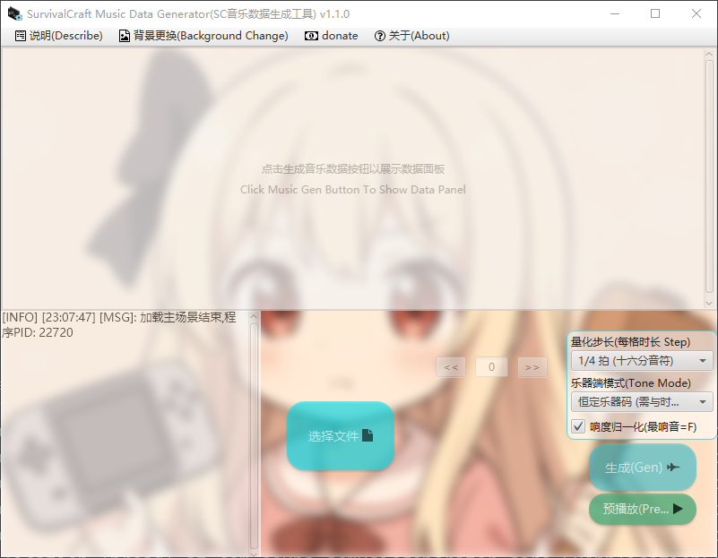
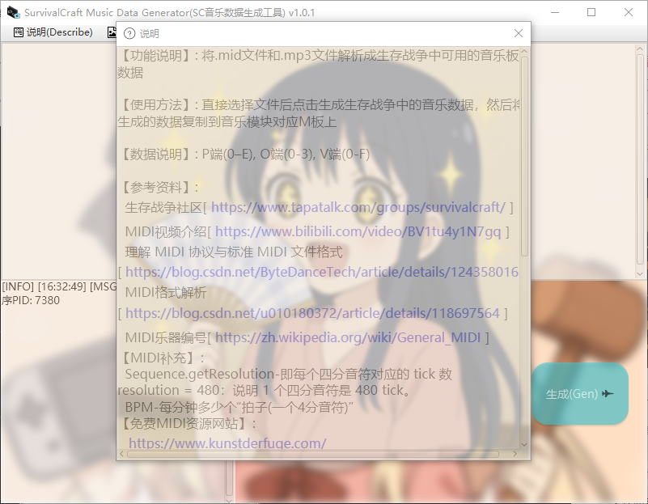
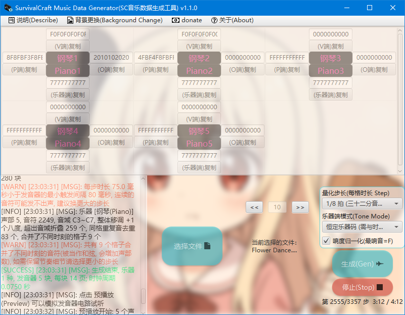

<h1 align="center">生存战争音乐数据生成器</h1> 

# SCMusicGenerator(SurvivalCraft Music Data Generator)

工具主要用于将MIDI文件生成生存战争可用的音乐数据，这款工具将告诉你需要多少个音乐板，以及每个音乐板所需要的音乐数据，
例如响度，八度，乐器代码以及音高数据。

使用方法也非常简单，将你的MIDI数据放到工具中，选好步长后点击生成即可。注意如果是MP3文件，需要在选择文件后先将文件转为MIDI文件再进行数据生成

# 转换规则

- **统一时间网格**：存储板(M板)的 1 个格子 = 1 个量化步长（默认 1/4 拍，可在界面上选择 1/8 拍 ~ 1 拍或固定毫秒）。所有乐器共用同一条时间轴，第 N 个格子就是乐曲的第 N 个步长，长音 = 1 个发音格 + 若干休止格（P=F，V=0）。日志里会给出**电路时钟周期**（秒），把计数器的时钟调成这个周期即可还原节奏。
- **声部**：同一个格子里同一乐器的多个音会分配到多块发音器（钢琴1、钢琴2……），需要的发音器数量 = 最大同时发声数；每块发音器每页 4 块存储板，所有声部的第 N 页在时间上对齐。
- **音高**：按游戏公式 `MIDI 音符 = 48 + 12 × O + P`（八度 0 = C3，八度 1 = 中央 C 所在八度）做绝对映射；风琴八度 0~2，其它乐器 0~3。超出音域的乐曲会整体按八度移调，仍超出的音折叠回音域内，日志中有说明。
- **乐器**：按 GM 音色映射到铃铛/风琴/砰/弦乐/小号/语音/钢琴/钢琴延音/贝斯，通道 10 固定为鼓，GM 打击乐音符映射到游戏的 10 种鼓声（0 军鼓 1 底鼓 2 闭镲 3 踩镲 4 开镲 5 低音桶鼓 6 高音桶鼓 7 吊镲 8 叮叮镲 9 拍手）。
- **乐器端是触发端**：发音器只在乐器端 0→非 0 时发声。默认“恒定乐器码”模式需要把乐器端存储板的输出与时钟脉冲（电平 F）过一个 AND 门；“脉冲”模式会在每个音后自动补一格 0，不需要 AND 门，但每块板只能存 128 步。
- **响度**：`V = round(力度 / 127 × 15)`，勾选“响度归一化”时以乐曲中最响的音为 F。

详细的游戏规则与代码审核见 [转换代码审核报告](./转换代码审核报告.md)。

# 工具界面

1. 主界面(Main Window)
   
2. 说明
   
3. 生成成功后
    
